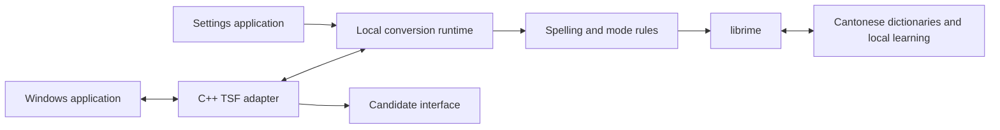

# Cantonese Windows IME research and implementation plan

Research date: 22 October 2026, Hong Kong time.

Scope update: the user has deferred Windows installation and integration testing
and asked for the typing engine and dictionary first. The working implementation
is now an independent Python reference decoder over licensed Cantonese data;
[ENGINE.md](ENGINE.md) and the project README describe the current build. The
sequence and librime-runtime recommendation below are the initial research
proposal, retained as background for later Windows work.

Build an offline Windows Cantonese IME with forgiving phonetic spelling, good phrase suggestions, and a simple installation experience. Reuse librime and Cantonese language data for the first version. Evaluate an existing Windows frontend before committing to a new Text Services Framework implementation. The main uncertainty is whether the proposed spelling behaviour produces useful candidates without damaging standard Jyutping accuracy.

## Existing Windows options

Third-party native Cantonese input methods already exist. The opportunity for this project is to make pronunciation-based Cantonese typing easier for people who do not know a formal romanization scheme.

| Option | What it provides | Role in this project |
| --- | --- | --- |
| Weasel with Rime Cantonese | A Windows Rime frontend and a maintained Cantonese schema | First baseline for dictionary coverage and schema experiments |
| Current TypeDuck Windows | A Cantonese TSF frontend, candidate UI, settings, installer, and separate Rime runtime | First candidate for extending an existing product architecture |
| CPIME | Several Cantonese romanization schemes and Windows installation guidance | Additional behaviour reference; no reusable source license established |
| Microsoft SampleIME | C++ TSF example | Reference for Windows interfaces if a new adapter becomes necessary |

[Weasel](https://github.com/rime/weasel) documents Windows 8.1–11 support and uses GPLv3. [Rime Cantonese](https://github.com/rime/rime-cantonese) supplies the language schema and data. [Current TypeDuck Windows](https://github.com/TypeDuck-HK/TypeDuck-Windows/blob/main/README.md) documents a TSF implementation registered under Chinese Traditional Hong Kong. Its current architecture differs from the archived Weasel-based legacy version. [CPIME](https://www.cpime.hk/p/cantonese-pinyin-input-software.html?lang=en) is another native option. These are upstream claims; this project has not tested their installed Windows behaviour.

## Behaviour to reproduce

Google's Cantonese IME accepts informal spelling and offers phrase conversion. Its documented examples include several spellings for the same sound, explicit apostrophe boundaries, candidate selection with Space or number keys, and Enter for literal Latin text. The live online demo returned 你 as its first candidate for `lay` during this research. [Google Cantonese input guide](https://www.google.com/intl/ka/inputtools/services/features/input-method.html), [live demo](https://www.google.com/inputtools/try/).

The other reference uses a Sidney Lau-based spelling scheme with additional common spellings, tone-free entry, word completion, and English-to-Chinese lookup. Its default Space behaviour pages candidates. A live check of `bohim` returned 保險 first. This is a different spelling and keybinding model from Google's. [cantoneseinput.com](https://www.cantoneseinput.com/).

Use these products as behaviour references. Google's attribution page identifies both open and separately licensed Cantonese content; it does not grant a license to copy the complete engine, service, or dictionary. No reuse permission for cantoneseinput.com's data was established. Build spelling mappings and test sentences independently, and obtain dictionaries from explicit upstream licenses. [Google content attribution](https://www.google.com/inputtools/help/attribution.html).

## Proposed first version

Assumption pending product feedback: forgiving spelling is the default, with a separate standard Jyutping mode. Traditional Chinese with Hong Kong character preferences is the initial output. Windows 10 x64 is the local test environment; Windows 11 support needs an independent validation pass.

The first version should provide:

- Offline character and phrase conversion, including ordinary written Cantonese vocabulary.
- Continuous tone-free typing, with apostrophes available to clarify syllable boundaries. Space is reserved for candidate commit.
- A selectable Jyutping mode that preserves its spelling distinctions.
- Candidates near the caret, optional pronunciation hints, keyboard navigation, and mouse selection.
- Space to commit the highlighted candidate, number keys to select, Enter to commit literal Latin input, and Escape to cancel composition. Paging uses dedicated keys. This intentionally follows the proposed product interaction, rather than the reference site's Space default.
- English mode, standard shortcut passthrough, and predictable punctuation.
- Local preference storage and an explicit switch for learning from selected candidates.
- Installation, removal, and updates that preserve user data by default.

Defer English-definition lookup, cloud sync, dictation, handwriting, broad sentence prediction improvements, and ARM64 support until the core typing and host-app compatibility are demonstrated. English-definition lookup needs a separate bilingual dataset; phonetic Cantonese dictionaries alone do not supply it.

## Engine and spelling design

Use canonical Jyutping internally. Keep each candidate's original pronunciation and text, while retaining the user's raw spelling in the composition buffer. Generate alternate interpretations at syllable boundaries instead of replacing letters globally. For example, `j` has different meanings across romanization schemes; unconditional substitution would corrupt legitimate input.

Start with a small, documented set of aliases and optional pronunciation mergers. Keep exact Jyutping matches ahead of fuzzy alternatives when the mode and context permit. Limit the number of interpretations so ambiguous input cannot create unbounded work. Use phrase context and measured candidate ranking to resolve ambiguity.

Rime Cantonese already includes tone omission, initial abbreviations, and selected spelling variants. Its schema exposes additional pronunciation mergers as options. The stock schema accepts tones through letter encodings such as `v`, `x`, and `q`; it does not directly provide the proposed numeric-tone typing experience. [Actual Rime Cantonese schema](https://raw.githubusercontent.com/rime/rime-cantonese/main/jyut6ping3.schema.yaml).

For standard mode, explicitly disable the stock schema's spelling-tolerance derive rules, including its `aa/a` and `eo/oe` aliases. Keep tone omission available. A separate custom schema is necessary to preserve standard spelling distinctions; selecting the stock schema alone does not achieve that.

For the MVP, preserve Rime's Jyutping tone key encoding in Jyutping mode and keep number keys for candidates. The `v/x/q` keys are an input convention, not standard Jyutping tone notation. If numeric tones are later added, introduce an explicit numeric-tone mode with a documented candidate shortcut such as Alt+number. Do not let the same digit unpredictably mean both a tone and a candidate selection.

Prototype aliases through Rime schema algebra first. If candidate quality requires weighted spelling costs, measure a small custom translator or filter. Treat weighted decoding as extra work: schema aliases alone do not establish Google-equivalent ranking. Expand the evaluation set before expanding the fuzzy rules.

## Windows architecture

Microsoft's supported foundation is Text Services Framework, or TSF. It connects an IME to editable text in applications and handles composition through COM interfaces. An IMM32-only implementation is unsuitable for modern Windows apps. The in-process DLL inherits host restrictions, which also makes a network-dependent conversion engine a poor default. [Microsoft custom IME requirements](https://learn.microsoft.com/en-us/windows/apps/develop/input/input-method-editor-requirements).

Recommended logical structure:

Keep the Windows adapter thin. The conversion runtime owns parsing, candidate generation, and mutable learning data. A shared runtime also avoids separate x86 and x64 hosts writing independently to the same user database. The adapter owns document composition and delivers candidate state to the UI. A separate process can isolate engine failures, although its IPC path must remain responsive and requires compatibility testing.

TypeDuck demonstrates this split with a C++ TSF DLL, a launcher, and a Go/librime runtime. Evaluate that implementation first. If adapting it meets the product needs, retain its existing language and build choices. If it cannot meet the required integration or distribution constraints, implement a small C++ TSF adapter and local librime host. A fresh conversion engine is outside the MVP scope. [TypeDuck architecture](https://github.com/TypeDuck-HK/TypeDuck-Windows/blob/main/README.md), [backend](https://github.com/TypeDuck-HK/TypeDuck-Windows-backend).

For a new adapter, the main interfaces and obligations are:

| Area | Implementation work |
| --- | --- |
| Lifecycle | `ITfTextInputProcessorEx`, COM class factory, activation and deactivation |
| Keyboard | `ITfKeyEventSink`, focus handling, shortcut and noneditable-context passthrough |
| Text changes | `ITfEditSession` and `ITfContext::RequestEditSession`; change host text only within granted access |
| Composition | `ITfContextComposition` and `ITfComposition`; track preedit, commit, cancellation, and host termination |
| Candidates | `ITfCandidateListUIElement` and behaviour interface; honour host rendering decisions |
| Presentation | Composition display attributes, caret location, focus/layout notifications, DPI and accessibility |
| Mode | TSF compartments and input indicator integration |

The details are documented in [key events](https://learn.microsoft.com/en-us/windows/win32/api/msctf/nn-msctf-itfkeyeventsink), [edit sessions](https://learn.microsoft.com/en-us/windows/win32/api/msctf/nf-msctf-itfcontext-requesteditsession), [composition creation](https://learn.microsoft.com/en-us/windows/win32/api/msctf/nf-msctf-itfcontextcomposition-startcomposition), [UILess candidates](https://learn.microsoft.com/en-us/windows/win32/tsf/uiless-mode-overview), and [compartments](https://learn.microsoft.com/en-us/windows/win32/tsf/predefined-compartments). Microsoft's [SampleIME](https://github.com/microsoft/Windows-classic-samples/tree/main/Samples/IME) is educational scaffolding with older build assumptions and a documented candidate-window fix.

Use versioned, bounded IPC messages, one session per text context, and request generations to discard stale candidate responses after focus changes. Specify cancellation, timeouts, authenticated endpoint/session access, and recovery without raw-text logging. A backend failure must not freeze the application or silently lose the composition buffer. Restrict IPC to the intended user/session and test elevated and AppContainer clients before selecting the frontend. Do not assume an ordinary desktop named pipe is accessible from every host, or weaken application isolation to make it work. If this early gate fails, reconsider the broker design or a read-only in-process engine before substantial product work.

## Dictionaries and distribution inventory

| Component | Upstream license declaration | Proposed handling |
| --- | --- | --- |
| librime | BSD 3-Clause | Retain notices; pin engine and dependency versions |
| Main Rime Cantonese schema and dictionary | CC BY 4.0 | Include authorship, source, license, and modification information |
| `jyut6ping3.maps` | ODbL 1.0 | Exclude from the first custom dictionary build, including its import entry |
| LSHK Jyutping table | CC BY 4.0 | Possible smaller character-reading source for an isolated spike |
| Weasel frontend | GPLv3 | Use as a baseline; assess source-distribution duties before shipping a derivative |
| Current TypeDuck frontend and backend | MIT at repository level | Review all retained components individually |
| TypeDuck libIME2 and dictionary lookup filter | LGPL 2.1 in its notices | Assess the exact modification and linking arrangement before distribution |

Sources: [librime license](https://github.com/rime/librime/blob/master/LICENSE), [Rime Cantonese license scope](https://raw.githubusercontent.com/rime/rime-cantonese/main/README-en.md), [dictionary import list](https://raw.githubusercontent.com/rime/rime-cantonese/main/jyut6ping3.dict.yaml), [LSHK table](https://github.com/lshk-org/jyutping-table), [TypeDuck notices](https://github.com/TypeDuck-HK/TypeDuck-Windows/blob/main/THIRD_PARTY_NOTICES.txt). Additional phrase provenance is described by [Rime Cantonese upstream](https://github.com/CanCLID/rime-cantonese-upstream).

This is an initial component inventory, not a completed distribution audit. Freeze the actual dependency graph and retain each applicable license before releasing a package. Neither a permissive engine license nor a repository-level license covers every optional dataset and plugin.

## Installation and support

Build x64 and x86 text-service DLLs from the same source for x64 Windows. A 32-bit application requires a matching in-process COM server even on a 64-bit OS. ARM64 needs its own binaries and host testing. [Microsoft architecture guidance](https://learn.microsoft.com/en-us/windows/win32/tsf/64-bit-platform-considerations), [ARM64 interoperability](https://learn.microsoft.com/en-us/windows/arm/arm64ec).

Use a conventional installer for the first release, with architecture-correct COM registration, a Hong Kong Traditional Chinese language profile, and TSF capability registration. Verify discovery through Windows Settings and Win+Space. Do not change the user's default keyboard through direct registry edits. Provide a reliable unregister/uninstall path. [Text service registration](https://learn.microsoft.com/en-us/windows/win32/tsf/text-service-registration), [profile registration](https://learn.microsoft.com/en-us/windows/win32/api/msctf/nf-msctf-itfinputprocessorprofilemgr-registerprofile).

Plan for signed release binaries and a timestamped installer. Verify the selected development signing and loading process before the native spike; unsigned builds are not a reliable compatibility assumption. A machine-wide COM installation is the initial approach for elevated-host compatibility. [Microsoft IME overview](https://learn.microsoft.com/en-us/windows/apps/develop/input/input-method-editors), [SignTool](https://learn.microsoft.com/en-us/windows/win32/seccrypto/signtool), [COM elevation behaviour](https://learn.microsoft.com/en-us/windows/win32/com/the-com-elevation-moniker).

Keep runtime input and learning local. Provide learning disable/reset controls and avoid recording raw typed text in routine diagnostics. Respect disabled and sensitive input contexts. Password input should disable text services; a password input-scope label alone is not a security boundary. [Microsoft input scopes](https://learn.microsoft.com/en-us/windows/win32/api/inputscope/ne-inputscope-inputscope).

Windows sign-in screen support is outside scope: Microsoft reports third-party IMEs unavailable there after the October 2024 security change. [KB5046254](https://support.microsoft.com/en-us/servicing/os/windows/2024/09/kb5046254-vulnerability-when-using-a-third-party-input-method-editor-at-the-microsoft-windows-sign-i).

## Implementation sequence

Effort below is a planning estimate for one experienced developer working mostly full time, using an existing engine and frontend. It is not a delivery commitment. A new TSF implementation, data cleanup, or unresolved host restrictions would extend it.

| Stage | Work | Exit condition | Indicative effort |
| --- | --- | --- | --- |
| 0. Baseline and toolchain | Install supported C++ build tools/SDK; pin upstream revisions; compare TypeDuck and Weasel; smoke-test backend access from restricted and elevated hosts; collect a small user-reviewed spelling corpus | Reproducible upstream build, viable IPC, and recorded baseline; frontend choice documented | 2–4 days |
| 1. Conversion prototype | Add forgiving and Jyutping schemas; replay input through the real Rime API; measure ranking and latency | Required seed phrases appear; no standard-spelling regressions; first 200 evaluation cases recorded | 1–2 weeks |
| 2. Native integration | Adapt the selected frontend; composition, caret candidates, English mode, focus and host UI handling | Correct commit/cancel and input switching in x64 and x86 desktop hosts | 1–2 weeks |
| 3. Compatibility and packaging | AppContainer/elevated hosts, Electron and browser edits; settings, signing, install/upgrade/uninstall | Compatibility matrix passes; installer can recover from locked files and preserve user data | 2–3 weeks |
| 4. Typing trial | Expand to 500 or more held-out phrases and natural spelling variants; fix ranking and interoperability issues | Quality targets met on Windows 10 and Windows 11; daily typing trial completed | 2–4 weeks |

Allow roughly 7–12 weeks for a usable preview along this reuse path. A minimal working demonstration should come earlier; daily-use reliability is a separate milestone. See [validation](VALIDATION.md) for the gates and current evidence.

## Immediate next milestone

Prepare a reproducible native build environment, then run a small real-librime conversion harness before registering this project's IME. Compare exact Jyutping, forgiving spelling, and phrase segmentation on the seed cases. Choose TypeDuck extension or a new TSF adapter based on that evidence, early host/IPC smoke tests, and the dependency review.

For the TypeDuck route, its documented starting toolchain is Visual Studio 2022 with MSVC and Windows SDK, CMake 3.21 or newer, PowerShell 7, Inno Setup 6, Go matching the pinned backend module, and Protocol Buffers tooling matching the pinned repositories. Verify exact versions against the chosen revisions before installing. A .NET SDK is not a prerequisite for the proposed C++ TSF adapter. [TypeDuck build prerequisites](https://github.com/TypeDuck-HK/TypeDuck-Windows/blob/main/README.md).

The original environment probe found Python, Node, Git, and PowerShell, with no
usable C++ build environment in PATH or standard Visual Studio/SDK discovery
locations. Since that research, the user has deferred native work. The current
tree contains the offline Python engine, source-locked dictionary and mappings,
review ledgers and executable evidence described in [ENGINE.md](ENGINE.md).
Native installation and Windows host results remain pending.
